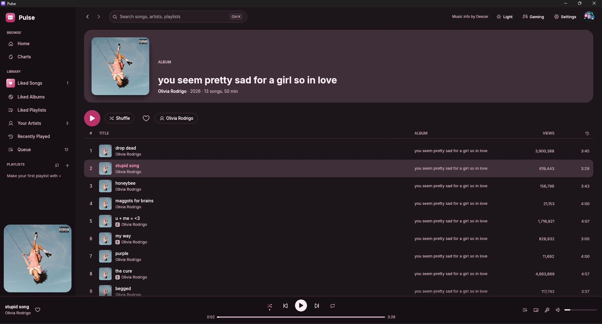

<p align="center">
  <picture>
    <source media="(prefers-color-scheme: dark)" srcset="assets/logo/logo-for-dark-backgrounds.svg">
    
  </picture>
</p>

<p align="center">
  <b>A fast, native music player for Windows, written in Rust.</b><br>
  Search any artist and play full songs, with autoplay when your queue runs out.<br>
  A small installer (or a single <code>.exe</code>), no account.
</p>

<p align="center">
  <a href="https://github.com/mercy123xz/Pulse/releases/latest"><b>⬇ Download for Windows</b></a>
  &nbsp;·&nbsp; <a href="#features">Features</a>
  &nbsp;·&nbsp; <a href="#keyboard-shortcuts">Shortcuts</a>
  &nbsp;·&nbsp; <a href="#building-from-source">Build from source</a>
</p>

<!-- Add a screenshot: save it as assets/screenshot.png, then delete these comment markers.
<p align="center"></p>
-->

## Features

**Discover**
- **Home:** today's top songs, popular albums, artists and playlists, and quick genre picks
- **Charts:** the top 100 songs overall or in 27 genres
- **Live search** for songs, artists, albums and playlists as you type
- **Artist pages** with their latest release, most popular songs, full discography and similar artists
- **Album and playlist pages** with cover art

**Listen**
- Full-length songs, found and streamed from YouTube automatically
- **Autoplay:** when your queue runs out, Pulse keeps playing similar songs (turn it off in the Queue)
- The next song is found while the current one plays, so tracks change without a wait
- Queue with **Play next** and **Add to queue**, plus shuffle and repeat (all or one)
- Picks up where you left off: your last song, volume and settings are remembered

- Right-click any song to like it, add it to a playlist or the queue, see its credits, download it,
  or copy a YouTube, Spotify or Deezer link to share
- **Equalizer** with presets, **crossfade** (up to 10 s), **gapless playback**, **automix** and mono audio
- YouTube view counts next to songs

**Your library**
- **Liked Songs**, **Recently Played** and your **own playlists**, with custom covers, search,
  genre filters, sorting and "date added"
- **Import playlists** from YouTube, Spotify or SoundCloud by pasting a link
- **Download songs** for offline listening, and play the music files in your **Music folder**
- Everything is saved on your PC. No account or sign-in needed

**Make it yours**
- Four built-in **themes** (Default, Blossom, Dreary Mono, Lunar), each with dark and light colors
- Make your own themes, Spicetify-style: `color.ini`, a little CSS and a `theme.toml`. Spicetify
  color schemes work as they are, and Pulse reloads a theme the moment you save it
- English, Español, Português, Français and Deutsch

**Made for everyone**
- High contrast mode
- Full keyboard control and screen-reader support, with text colors that meet WCAG AA contrast
- A true desktop app with no web browser inside. It runs on any 64-bit Windows 10 or 11 PC, even one without a graphics driver

## Download

1. Grab **`PulseSetup-x.y.z.exe`** from the [latest release](https://github.com/mercy123xz/Pulse/releases/latest).
2. Run it. It installs Pulse for your user account (no administrator password), adds it to the
   Start menu, and can add a desktop shortcut. Uninstall it from Windows Settings → Apps.

Prefer no installer? Download **`pulse.exe`** from the same page and just double-click it.

The first time you run either one, Windows may show **"Windows protected your PC"**. It does that for any
new app that isn't signed with a paid certificate. Click **More info → Run anyway**.

The first time you play a song, Pulse downloads two free tools it needs for YouTube playback,
[yt-dlp](https://github.com/yt-dlp/yt-dlp) and [Deno](https://deno.com) (about 70 MB, once). It gets
them from their official GitHub releases and checks them against the published checksums. After
that, songs start in a few seconds, and Pulse updates yt-dlp by itself once a day so playback keeps
working when YouTube changes.

Your likes, playlists, settings, themes and those tools are stored in `%APPDATA%\pulse-player`.
Uninstalling keeps that folder, so reinstalling picks up where you left off; delete it if you want
everything gone.

## Keyboard shortcuts

| Action | Keys |
|---|---|
| Play / pause | <kbd>Space</kbd> |
| Next / previous song | <kbd>Ctrl</kbd> + <kbd>→</kbd> / <kbd>Ctrl</kbd> + <kbd>←</kbd> |
| Volume up / down | <kbd>Ctrl</kbd> + <kbd>↑</kbd> / <kbd>Ctrl</kbd> + <kbd>↓</kbd> |
| Mute | <kbd>M</kbd> |
| Shuffle / repeat | <kbd>S</kbd> / <kbd>R</kbd> |
| Search | <kbd>Ctrl</kbd> + <kbd>K</kbd> |
| Back / forward between pages | <kbd>Alt</kbd> + <kbd>←</kbd> / <kbd>Alt</kbd> + <kbd>→</kbd> (or your mouse's side buttons) |
| Move between buttons and songs | <kbd>Tab</kbd> / <kbd>Shift</kbd> + <kbd>Tab</kbd> |
| On a selected song: play / add to queue / play next | <kbd>Enter</kbd> / <kbd>Q</kbd> / <kbd>N</kbd> |
| Quit | <kbd>Ctrl</kbd> + <kbd>Q</kbd> |

Right-click any song for more options, like adding it to one of your playlists.

## Building from source

You need [Rust](https://rustup.rs). On Windows, the installer offers to set up the Visual Studio C++
Build Tools too; say yes.

```powershell
git clone https://github.com/mercy123xz/Pulse.git
cd Pulse
cargo run --release
```

The first build takes a few minutes. The finished app is at `target\release\pulse.exe`.

Every push to this repository also builds `pulse.exe` automatically: open the **Actions** tab,
pick the latest **Build Windows app** run, and download the `pulse-windows` artifact.

On Linux you'll also need the ALSA development headers (`sudo apt install libasound2-dev`).

### How the code is organised

| File | What it does |
|---|---|
| `src/main.rs` | Opens the window and picks the graphics backend (DirectX 12 on Windows) |
| `src/deezer.rs` | Song info, artwork and charts from the Deezer API: search, artists, albums, playlists, similar songs |
| `src/youtube.rs` | YouTube playback: installs and updates yt-dlp and Deno, finds the matching video, gets the audio link, view counts |
| `src/audio.rs` | Audio engine: two decks for crossfade, opens the next song early for gapless playback, streams in chunks |
| `src/dsp.rs` | Sound processing on every song: equalizer, mono, fades, silence detection for automix |
| `src/import.rs` | Importing playlists from YouTube, Spotify and SoundCloud |
| `src/downloads.rs` | Downloading songs for offline listening |
| `src/local.rs` | Songs from the Music folder |
| `src/net.rs` | Shared HTTP helpers |
| `src/app.rs` | App logic: pages and history, the queue, shuffle and repeat, likes, playlists, saving |
| `src/settings.rs` | Everything on the Settings page, and where Pulse keeps its files |
| `src/i18n.rs` | Translations |
| `src/ui.rs`, `src/ui/settings_page.rs` | Everything you see: sidebar, top bar, pages, player bar, settings, dialogs |
| `src/widgets.rs` | Custom-drawn pieces: song rows, cards, sliders, buttons, accessibility helpers |
| `src/theme.rs` | Fonts, the active theme, and the contrast check |
| `src/themes.rs`, `assets/themes/` | The theme loader (color.ini, user.css, theme.toml) and the built-in themes |
| `build.rs` | Bakes the Visual C++ runtime and the icon into the Windows `.exe` |
| `installer/pulse.iss` | The Windows installer (Inno Setup) |

Run the tests with `cargo test`.

## Built with

- [egui / eframe](https://github.com/emilk/egui): the user interface
- [wgpu](https://wgpu.rs): graphics through DirectX 12 on Windows
- [rodio](https://github.com/RustAudio/rodio) and [Symphonia](https://github.com/pdeljanov/Symphonia): audio playback and MP3/AAC decoding
- [yt-dlp](https://github.com/yt-dlp/yt-dlp) and [Deno](https://deno.com): finding and streaming songs from YouTube (downloaded on first use)
- [Deezer API](https://developers.deezer.com/api): song info, artwork and charts
- [ureq](https://github.com/algesten/ureq) with [rustls](https://github.com/rustls/rustls): networking
- [Inno Setup](https://jrsoftware.org/isinfo.php): the installer
- [Phosphor Icons](https://phosphoricons.com) and the [Inter](https://rsms.me/inter/) typeface (SIL Open Font License)

## About the music

Song info, artwork and charts come from the free [Deezer API](https://developers.deezer.com/api).
The audio is streamed from YouTube using yt-dlp. Streaming YouTube outside its own apps may go
against YouTube's Terms of Service; use Pulse for personal listening and support the artists you
enjoy. Pulse only plays full songs: if YouTube can't play one, Pulse says so and you can skip to the next.

Playlist import reads the public pages of YouTube, Spotify and SoundCloud playlists, the same
pages anyone can open in a browser, and needs no account. View counts are YouTube's public view
counts for the video Pulse plays.

Pulse is an independent project and isn't affiliated with or endorsed by Deezer, YouTube, Google,
Spotify or SoundCloud.
